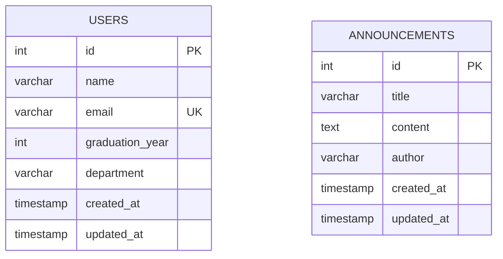

# Data Design Documentation (DDD)

> Back to [README.md](README.md)

This document describes the database design of the Alumni Tracking System. The tables below are created by the migration in [section 7](#7-migrations), and the app reads and writes them through the models in `app/models/` (see [section 8](#8-from-in-memory-models-to-tables)).

## 1. Why a Database

The app first stored records in memory. The "forgetting test" showed the problem:

1. Create a user and an announcement.
2. Run `docker compose down` followed by `docker compose up`.
3. Check the records: both lists came back empty.

Restarting the container wiped the Python process's memory, so all data was lost. A database keeps data on disk, independent of the app process, so records survive restarts. After connecting the app to PostgreSQL, the same test passes: the records are still there after `down` and `up`.

## 2. Database Choice

| Decision | Choice | Reason |
| --- | --- | --- |
| DBMS | PostgreSQL 16 | Already defined as the `db` service in `docker-compose.yml`, with a persistent `pgdata` volume. |
| Connection | `DATABASE_URL=postgresql://USER:PASSWORD@db:5432/DB_NAME` | Passed to the `api` service as an environment variable. The real values live in `.env` (git ignored); `.env.example` is the committed template. See the Environment Variables section of the README. |
| Credentials | `POSTGRES_USER`, `POSTGRES_PASSWORD`, `POSTGRES_DB` | Read from `.env` by `docker-compose.yml`, no longer hard-coded. They apply only when the `pgdata` volume is first created. |
| Access from Python | SQLAlchemy + psycopg2 | Both are already listed in `requirements.txt`. |
| Startup order | `db` healthcheck (`pg_isready`) + `depends_on: condition: service_healthy` | The `api` container starts only after PostgreSQL accepts connections, so the app never tries to connect to a database that is still booting. |
| Table creation | Alembic migrations (`migrations/`) | Tables are created by running `alembic upgrade head` inside the `api` container. See section 7. |

## 3. Entities

The system has two entities today, matching the two existing models:

- **User**: an MIS graduate (alumnus/alumna) tracked by the system.
- **Announcement**: a news item or notice published to graduates (e.g. a graduation ceremony, a job posting, an event).

## 4. Tables

### 4.1 `users`

| Column | Type | Constraints | Description |
| --- | --- | --- | --- |
| `id` | `SERIAL` | `PRIMARY KEY` | Auto-incremented identifier. |
| `name` | `VARCHAR(100)` | `NOT NULL` | Full name of the graduate. |
| `email` | `VARCHAR(255)` | `NOT NULL`, `UNIQUE` | Contact email. Unique so the same person cannot be registered twice. |
| `graduation_year` | `INTEGER` | `NOT NULL`, `CHECK (graduation_year BETWEEN 1950 AND 2100)` | Year of graduation. |
| `department` | `VARCHAR(100)` | `NOT NULL` | Department graduated from. |
| `created_at` | `TIMESTAMP` | `NOT NULL`, `DEFAULT CURRENT_TIMESTAMP` | When the record was created. |
| `updated_at` | `TIMESTAMP` | `NOT NULL`, `DEFAULT CURRENT_TIMESTAMP` | When the record was last changed. |

### 4.2 `announcements`

| Column | Type | Constraints | Description |
| --- | --- | --- | --- |
| `id` | `SERIAL` | `PRIMARY KEY` | Auto-incremented identifier. |
| `title` | `VARCHAR(200)` | `NOT NULL` | Headline of the announcement. |
| `content` | `TEXT` | `NOT NULL` | Body text, no length limit. |
| `author` | `VARCHAR(100)` | `NOT NULL` | Who published it (e.g. "Department Office"). |
| `created_at` | `TIMESTAMP` | `NOT NULL`, `DEFAULT CURRENT_TIMESTAMP` | When the announcement was published. |
| `updated_at` | `TIMESTAMP` | `NOT NULL`, `DEFAULT CURRENT_TIMESTAMP` | When it was last edited. |

## 5. Relationships



The two tables are **independent** for now: there is no foreign key between them. Announcements are published by the department, not by graduates, so `author` stays a free-text field rather than a reference to `users`.

**Open decision:** if announcements later need to be posted by registered accounts (e.g. admins), `author` should become `author_id INTEGER REFERENCES users(id)`, giving a one-to-many relationship (one user writes many announcements).

## 6. SQL Equivalent

```sql
CREATE TABLE users (
    id              SERIAL PRIMARY KEY,
    name            VARCHAR(100) NOT NULL,
    email           VARCHAR(255) NOT NULL UNIQUE,
    graduation_year INTEGER      NOT NULL CHECK (graduation_year BETWEEN 1950 AND 2100),
    department      VARCHAR(100) NOT NULL,
    created_at      TIMESTAMP    NOT NULL DEFAULT CURRENT_TIMESTAMP,
    updated_at      TIMESTAMP    NOT NULL DEFAULT CURRENT_TIMESTAMP
);

CREATE TABLE announcements (
    id         SERIAL PRIMARY KEY,
    title      VARCHAR(200) NOT NULL,
    content    TEXT         NOT NULL,
    author     VARCHAR(100) NOT NULL,
    created_at TIMESTAMP    NOT NULL DEFAULT CURRENT_TIMESTAMP,
    updated_at TIMESTAMP    NOT NULL DEFAULT CURRENT_TIMESTAMP
);
```

The SQL above is shown for reading. It is not run by hand: the migration below produces the same tables.

## 7. Migrations

Migrations are managed with [Alembic](https://alembic.sqlalchemy.org/). Each migration is a Python file in `migrations/versions/` with an `upgrade()` (apply) and a `downgrade()` (undo) function. Alembic remembers the current version in the `alembic_version` table.

| Revision | File | What it does |
| --- | --- | --- |
| `0001` | `migrations/versions/0001_create_users_and_announcements.py` | Creates `users` and `announcements` exactly as defined in section 4. Downgrade drops both tables. |

| Command (run in the project folder) | Meaning |
| --- | --- |
| `docker compose exec api alembic upgrade head` | Apply all migrations (create the tables). |
| `docker compose exec api alembic current` | Show which revision the database is at. |
| `docker compose exec api alembic downgrade base` | Undo all migrations (drops the tables and their data). |
| `docker compose exec api alembic revision -m "message"` | Create a new empty migration file for the next schema change. |

**How the constraints are enforced:** the `UNIQUE` on `users.email`, the `CHECK` on `users.graduation_year` and the `NOT NULL` columns are enforced by PostgreSQL itself. They were tested by inserting invalid rows, which the database rejected.

**Note on `updated_at`:** it only has a default at insert time. PostgreSQL does not update it automatically on `UPDATE`, so the application sets it in every update query (see section 8).

### 7.1 Factories and Seeding

Test data is generated by factories and inserted by a seeder. This does not change the schema.

| File | Role |
| --- | --- |
| `app/database/factories.py` | `UserFactory` and `AnnouncementFactory` build fake rows with [Faker](https://faker.readthedocs.io/). They respect the table rules: unique emails, `graduation_year` between 2005 and 2025, title within 200 characters. |
| `app/database/seed.py` | Seeder: inserts the factory rows into `users` and `announcements`. |
| `app/database/connection.py` | Creates the database connection from `DATABASE_URL`. |

| Command | Meaning |
| --- | --- |
| `docker compose exec api python -m app.database.seed` | Add 20 users and 10 announcements. |
| `docker compose exec api python -m app.database.seed --users 50 --announcements 5` | Choose the counts. |
| `docker compose exec api python -m app.database.seed --fresh` | Empty both tables and reset ids to 1 first, then seed. |
| `docker compose exec api python -m app.database.seed --seed 7` | Fixed random seed: the same data every run (use with `--fresh`). |

Without `--fresh`, each run adds more rows on top of the existing ones. The seeded data is for development only.

## 8. From In-Memory Models to Tables

The app is now connected to the database. `app/models/user.py` and `app/models/announcement.py` run SQL (through SQLAlchemy and the connection in `app/database/connection.py`) instead of changing Python lists.

| Before (in memory) | Now (database) | Change |
| --- | --- | --- |
| `users: list[dict]` | `users` table | Rows persist across restarts. |
| `id = len(users) + 1` | `SERIAL` | The database assigns ids. The old approach could repeat an id after a delete; `SERIAL` never reuses one. Ids can have gaps, for example when an insert is rejected by a constraint. |
| `email: str` (no rule) | `UNIQUE` | A duplicate email is rejected and the API answers `409 Conflict`. |
| `graduation_year: int` (no rule) | `CHECK` between 1950 and 2100 | Checked twice: by the Pydantic models (answer `422`) and by the database. |
| `announcements: list[dict]` | `announcements` table | Rows persist across restarts. |
| `created_at` as a formatted string | `TIMESTAMP` | Stored as a real date/time. The API still returns it formatted as `YYYY-MM-DD HH:MM`. |
| No `updated_at` | `updated_at` column | The model sets it to `CURRENT_TIMESTAMP` on every update, which resolves the limitation noted in section 7. |
| Missing id in a list | `404 Not Found` | Unchanged: a missing id still answers `404`. |

The API contracts (request/response fields in `/api/users` and `/api/announcements`) stay the same, so controllers and views did not need to change. `created_at` and `updated_at` of users are stored but not returned by the API.

## 9. Naming Conventions

- Table names are plural and lowercase: `users`, `announcements`.
- Column names use `snake_case`: `graduation_year`, `created_at`.
- Every table has an `id` primary key plus `created_at` and `updated_at` columns.
