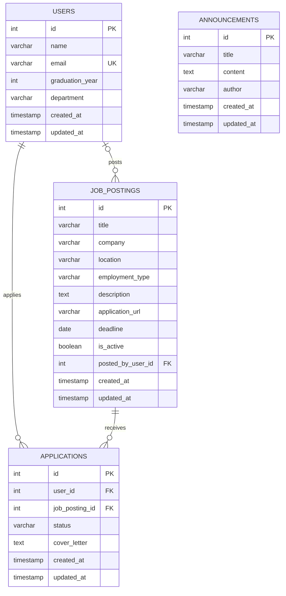

# Data Design Documentation (DDD)

> Back to [README.md](README.md)

This document describes the database design of the Alumni Tracking System. The tables below are created by the migrations in [section 7](#7-migrations), and the app reads and writes them through the models in `app/models/` (see [section 8](#8-from-in-memory-models-to-tables)).

> **Status:** all four tables (`users`, `announcements`, `job_postings`, `applications`) exist in the database: migrations `0001`, `0002` and `0003` have been applied (`alembic current` shows `0003 (head)`). The app uses `users` and `announcements` for its pages and API, and has JSON routes for `job_postings` and `applications` (sections [8.2](#82-routes-direct-and-nested) and [8.3](#83-applications-models-and-routes)). On a fresh database, run `alembic upgrade head` first.

## 1. Why a Database

The app first stored records in memory. The "forgetting test" showed the problem:

1. Create a user and an announcement.
2. Run `docker compose down` followed by `docker compose up`.
3. Check the records: both lists came back empty.

Restarting the container wiped the Python process's memory, so all data was lost. A database keeps data on disk, independent of the app process, so records survive restarts. After connecting the app to PostgreSQL, the same test passes: the records are still there after `down` and `up`.

## 2. Database Choice

| Decision | Choice | Reason |
| --- | --- | --- |
| DBMS | PostgreSQL 16 | Already defined as the `db` service in `docker-compose.yml`, with a persistent `pgdata` volume. |
| Connection | `DATABASE_URL=postgresql://USER:PASSWORD@db:5432/DB_NAME` | Passed to the `api` service as an environment variable. The real values live in `.env` (git ignored); `.env.example` is the committed template. See the Environment Variables section of the README. |
| Credentials | `POSTGRES_USER`, `POSTGRES_PASSWORD`, `POSTGRES_DB` | Read from `.env` by `docker-compose.yml`, no longer hard-coded. They apply only when the `pgdata` volume is first created. |
| Access from Python | SQLAlchemy + psycopg2 | Both are already listed in `requirements.txt`. |
| Startup order | `db` healthcheck (`pg_isready`) + `depends_on: condition: service_healthy` | The `api` container starts only after PostgreSQL accepts connections, so the app never tries to connect to a database that is still booting. |
| Table creation | Alembic migrations (`migrations/`) | Tables are created by running `alembic upgrade head` inside the `api` container. See section 7. |

## 3. Entities

The system has four entities:

- **User**: an MIS graduate (alumnus/alumna) tracked by the system.
- **Announcement**: a news item or notice published to graduates (e.g. a graduation ceremony, an event).
- **Job Posting**: a job or internship offer shared with graduates, optionally posted by a registered user (e.g. an alumnus hiring at their company).
- **Application**: a graduate's application to one job posting. It links a user and a job posting and carries its own data (status, cover letter).

## 4. Tables

### 4.1 `users`

| Column | Type | Constraints | Description |
| --- | --- | --- | --- |
| `id` | `SERIAL` | `PRIMARY KEY` | Auto-incremented identifier. |
| `name` | `VARCHAR(100)` | `NOT NULL` | Full name of the graduate. |
| `email` | `VARCHAR(255)` | `NOT NULL`, `UNIQUE` | Contact email. Unique so the same person cannot be registered twice. |
| `graduation_year` | `INTEGER` | `NOT NULL`, `CHECK (graduation_year BETWEEN 1950 AND 2100)` | Year of graduation. |
| `department` | `VARCHAR(100)` | `NOT NULL` | Department graduated from. |
| `created_at` | `TIMESTAMP` | `NOT NULL`, `DEFAULT CURRENT_TIMESTAMP` | When the record was created. |
| `updated_at` | `TIMESTAMP` | `NOT NULL`, `DEFAULT CURRENT_TIMESTAMP` | When the record was last changed. |

### 4.2 `announcements`

| Column | Type | Constraints | Description |
| --- | --- | --- | --- |
| `id` | `SERIAL` | `PRIMARY KEY` | Auto-incremented identifier. |
| `title` | `VARCHAR(200)` | `NOT NULL` | Headline of the announcement. |
| `content` | `TEXT` | `NOT NULL` | Body text, no length limit. |
| `author` | `VARCHAR(100)` | `NOT NULL` | Who published it (e.g. "Department Office"). |
| `created_at` | `TIMESTAMP` | `NOT NULL`, `DEFAULT CURRENT_TIMESTAMP` | When the announcement was published. |
| `updated_at` | `TIMESTAMP` | `NOT NULL`, `DEFAULT CURRENT_TIMESTAMP` | When it was last edited. |

### 4.3 `job_postings`

| Column | Type | Constraints | Description |
| --- | --- | --- | --- |
| `id` | `SERIAL` | `PRIMARY KEY` | Auto-incremented identifier. |
| `title` | `VARCHAR(200)` | `NOT NULL` | Position title (e.g. "Junior Data Analyst"). |
| `company` | `VARCHAR(150)` | `NOT NULL` | Hiring company. |
| `location` | `VARCHAR(150)` | `NOT NULL` | City, or "Remote". |
| `employment_type` | `VARCHAR(20)` | `NOT NULL`, `CHECK (employment_type IN ('full_time', 'part_time', 'internship', 'contract'))` | Kind of position. A fixed list so filtering by type is reliable. |
| `description` | `TEXT` | `NOT NULL` | Responsibilities and requirements, no length limit. |
| `application_url` | `VARCHAR(500)` | nullable | Where to apply. Optional: some postings only give a contact in the description. |
| `deadline` | `DATE` | nullable | Last day to apply. Optional: some postings stay open until filled. |
| `is_active` | `BOOLEAN` | `NOT NULL`, `DEFAULT TRUE` | `FALSE` hides a filled or expired posting without deleting it. |
| `posted_by_user_id` | `INTEGER` | nullable, `REFERENCES users(id) ON DELETE SET NULL` | The user who shared the posting. `NULL` when the department posts it, or when the user is later deleted. |
| `created_at` | `TIMESTAMP` | `NOT NULL`, `DEFAULT CURRENT_TIMESTAMP` | When the posting was created. |
| `updated_at` | `TIMESTAMP` | `NOT NULL`, `DEFAULT CURRENT_TIMESTAMP` | When it was last edited. |

| Index | Columns | Reason |
| --- | --- | --- |
| `ix_job_postings_posted_by_user_id` | `posted_by_user_id` | PostgreSQL does not index foreign keys automatically. This keeps "postings by this user" lookups and user deletes fast. |

### 4.4 `applications`

| Column | Type | Constraints | Description |
| --- | --- | --- | --- |
| `id` | `SERIAL` | `PRIMARY KEY` | Auto-incremented identifier. |
| `user_id` | `INTEGER` | `NOT NULL`, `REFERENCES users(id) ON DELETE CASCADE` | The graduate who applied (the applicant). |
| `job_posting_id` | `INTEGER` | `NOT NULL`, `REFERENCES job_postings(id) ON DELETE CASCADE` | The posting applied to. |
| `status` | `VARCHAR(20)` | `NOT NULL`, `DEFAULT 'submitted'`, `CHECK (status IN ('submitted', 'under_review', 'interview', 'accepted', 'rejected', 'withdrawn'))` | Where the application stands. A fixed list, so filtering by status is reliable. |
| `cover_letter` | `TEXT` | nullable | Optional motivation text written by the applicant. |
| `created_at` | `TIMESTAMP` | `NOT NULL`, `DEFAULT CURRENT_TIMESTAMP` | When the application was submitted. |
| `updated_at` | `TIMESTAMP` | `NOT NULL`, `DEFAULT CURRENT_TIMESTAMP` | When it was last changed (e.g. the status moved on). |

| Constraint / Index | Columns | Reason |
| --- | --- | --- |
| `uq_applications_user_id_job_posting_id` (`UNIQUE`) | `user_id`, `job_posting_id` | A graduate can apply to a given posting only once. Its index also serves "applications of this user" lookups, because `user_id` is its first column. |
| `ix_applications_job_posting_id` | `job_posting_id` | "Applicants of this posting" lookups and posting deletes stay fast (PostgreSQL does not index foreign keys automatically). |

## 5. Relationships



**`users` → `job_postings` (one-to-many, optional):** one user can post many job postings; each posting is posted by at most one user. The link is `job_postings.posted_by_user_id → users.id`.

- It is nullable, so the department can publish a posting that belongs to no user.
- `ON DELETE SET NULL`: deleting a user keeps their postings and only clears `posted_by_user_id`. Job postings are still useful to other graduates after the poster leaves, so they should not be deleted with the user.

**`users` ↔ `job_postings` through `applications` (many-to-many):** a graduate can apply to many postings, and a posting can receive applications from many graduates. A many-to-many link cannot be stored in one column, so `applications` sits in between as a *join table*. Each row is one pair (applicant, posting) and carries its own data (`status`, `cover_letter`), which is why it is a full table and not just two ids.

- `applications.user_id → users.id` is **one-to-many**: one user, many applications.
- `applications.job_posting_id → job_postings.id` is **one-to-many**: one posting, many applications.
- Both columns are `NOT NULL`: an application without an applicant or without a posting makes no sense.
- Both use `ON DELETE CASCADE`: if a user is deleted, their applications go with them (personal data of a person who left); if a posting is deleted, applications to it go with it (they point to nothing). This differs from `job_postings.posted_by_user_id`, which uses `SET NULL`, because a posting is still useful without its poster, but an application is not useful without either side.
- `UNIQUE (user_id, job_posting_id)`: the same graduate cannot apply twice to the same posting.

**`announcements`** stays independent: there is no foreign key to it. Announcements are published by the department, not by graduates, so `author` stays a free-text field rather than a reference to `users`.

**Open decision:** if announcements later need to be posted by registered accounts (e.g. admins), `author` should become `author_id INTEGER REFERENCES users(id)`, giving a one-to-many relationship (one user writes many announcements).

## 6. SQL Equivalent

```sql
CREATE TABLE users (
    id              SERIAL PRIMARY KEY,
    name            VARCHAR(100) NOT NULL,
    email           VARCHAR(255) NOT NULL UNIQUE,
    graduation_year INTEGER      NOT NULL CHECK (graduation_year BETWEEN 1950 AND 2100),
    department      VARCHAR(100) NOT NULL,
    created_at      TIMESTAMP    NOT NULL DEFAULT CURRENT_TIMESTAMP,
    updated_at      TIMESTAMP    NOT NULL DEFAULT CURRENT_TIMESTAMP
);

CREATE TABLE announcements (
    id         SERIAL PRIMARY KEY,
    title      VARCHAR(200) NOT NULL,
    content    TEXT         NOT NULL,
    author     VARCHAR(100) NOT NULL,
    created_at TIMESTAMP    NOT NULL DEFAULT CURRENT_TIMESTAMP,
    updated_at TIMESTAMP    NOT NULL DEFAULT CURRENT_TIMESTAMP
);

CREATE TABLE job_postings (
    id                SERIAL PRIMARY KEY,
    title             VARCHAR(200) NOT NULL,
    company           VARCHAR(150) NOT NULL,
    location          VARCHAR(150) NOT NULL,
    employment_type   VARCHAR(20)  NOT NULL
                      CHECK (employment_type IN ('full_time', 'part_time', 'internship', 'contract')),
    description       TEXT         NOT NULL,
    application_url   VARCHAR(500),
    deadline          DATE,
    is_active         BOOLEAN      NOT NULL DEFAULT TRUE,
    posted_by_user_id INTEGER      REFERENCES users(id) ON DELETE SET NULL,
    created_at        TIMESTAMP    NOT NULL DEFAULT CURRENT_TIMESTAMP,
    updated_at        TIMESTAMP    NOT NULL DEFAULT CURRENT_TIMESTAMP
);

CREATE INDEX ix_job_postings_posted_by_user_id ON job_postings (posted_by_user_id);

CREATE TABLE applications (
    id             SERIAL PRIMARY KEY,
    user_id        INTEGER     NOT NULL REFERENCES users(id) ON DELETE CASCADE,
    job_posting_id INTEGER     NOT NULL REFERENCES job_postings(id) ON DELETE CASCADE,
    status         VARCHAR(20) NOT NULL DEFAULT 'submitted'
                   CHECK (status IN ('submitted', 'under_review', 'interview', 'accepted', 'rejected', 'withdrawn')),
    cover_letter   TEXT,
    created_at     TIMESTAMP   NOT NULL DEFAULT CURRENT_TIMESTAMP,
    updated_at     TIMESTAMP   NOT NULL DEFAULT CURRENT_TIMESTAMP,
    CONSTRAINT uq_applications_user_id_job_posting_id UNIQUE (user_id, job_posting_id)
);

CREATE INDEX ix_applications_job_posting_id ON applications (job_posting_id);
```

The SQL above is shown for reading. It is not run by hand: the migrations below produce the same tables.

## 7. Migrations

Migrations are managed with [Alembic](https://alembic.sqlalchemy.org/). Each migration is a Python file in `migrations/versions/` with an `upgrade()` (apply) and a `downgrade()` (undo) function. Alembic remembers the current version in the `alembic_version` table.

| Revision | File | What it does | Status |
| --- | --- | --- | --- |
| `0001` | `migrations/versions/0001_create_users_and_announcements.py` | Creates `users` and `announcements` exactly as defined in section 4. Downgrade drops both tables. | Applied |
| `0002` | `migrations/versions/0002_create_job_postings.py` | Creates `job_postings` (section 4.3) with its foreign key to `users` and its index. Downgrade drops the table. Depends on `0001`, because the foreign key needs `users` to exist. | Applied |
| `0003` | `migrations/versions/0003_create_applications.py` | Creates `applications` (section 4.4) with its two foreign keys, the unique pair and the index. Downgrade drops the table. Depends on `0002`, because it references both `users` and `job_postings`. | Applied |

`alembic upgrade head` applies the migrations that are missing, in order. It was run on the existing database (which already held 20 users and 10 announcements from the seeder): `0002` and `0003` were applied, the existing rows were untouched and `alembic current` now shows `0003 (head)`. `alembic check` reports "No new upgrade operations detected", so the ORM models match the real tables.

| Command (run in the project folder) | Meaning |
| --- | --- |
| `docker compose exec api alembic upgrade head` | Apply all migrations (create the tables). |
| `docker compose exec api alembic current` | Show which revision the database is at. |
| `docker compose exec api alembic downgrade base` | Undo all migrations (drops the tables and their data). |
| `docker compose exec api alembic revision -m "message"` | Create a new empty migration file for the next schema change. |

**How the constraints are enforced:** the `UNIQUE` on `users.email`, the `CHECK` on `users.graduation_year` and the `NOT NULL` columns are enforced by PostgreSQL itself. They were tested by inserting invalid rows, which the database rejected.

**Note on `updated_at`:** it only has a default at insert time. PostgreSQL does not update it automatically on `UPDATE`, so the application sets it in every update query (see section 8).

### 7.1 Factories and Seeding

Test data is generated by factories and inserted by a seeder. This does not change the schema.

| File | Role |
| --- | --- |
| `app/database/factories.py` | `UserFactory`, `AnnouncementFactory` and `JobPostingFactory` build fake rows with [Faker](https://faker.readthedocs.io/). They respect the table rules: unique emails, `graduation_year` between 2005 and 2025, title within 200 characters, `employment_type` from the allowed list. |
| `app/database/seed.py` | Seeder: inserts the factory rows into `users`, `announcements` and `job_postings`. |
| `app/database/connection.py` | Creates the database connection from `DATABASE_URL`. |

| Command | Meaning |
| --- | --- |
| `docker compose exec api python -m app.database.seed` | Add 20 users, 10 announcements and 15 job postings. |
| `docker compose exec api python -m app.database.seed --users 50 --announcements 5 --job-postings 30` | Choose the counts (`0` skips a table). |
| `docker compose exec api python -m app.database.seed --fresh` | Empty all four tables (including `applications`) and reset ids to 1 first, then seed. |
| `docker compose exec api python -m app.database.seed --seed 7` | Fixed random seed: the same data every run (use with `--fresh`). |

Without `--fresh`, each run adds more rows on top of the existing ones. The seeded data is for development only.

**Seeded job postings** (what `JobPostingFactory` produces, matching section 4.3):
- `posted_by_user_id` is picked from the users that exist in the table when the seeder runs, so the foreign key is always valid. About 75% of the postings belong to a user and about 25% are department postings (`NULL`). If there are no users at all, every posting is a department posting.
- `employment_type` is one of `full_time`, `part_time`, `internship`, `contract`. About 85% of the postings are active; about 70% have a `deadline` 10 to 90 days ahead, the rest have none (`NULL`); about 60% have an `application_url`.
- `applications` is not seeded. It is emptied by `--fresh`, because `TRUNCATE` on `users` and `job_postings` must include every table that points to them (PostgreSQL refuses otherwise), and applications cannot outlive the users and postings they belong to.

## 8. From In-Memory Models to Tables

The app is now connected to the database. `app/models/user.py` and `app/models/announcement.py` run SQL (through SQLAlchemy and the connection in `app/database/connection.py`) instead of changing Python lists.

| Before (in memory) | Now (database) | Change |
| --- | --- | --- |
| `users: list[dict]` | `users` table | Rows persist across restarts. |
| `id = len(users) + 1` | `SERIAL` | The database assigns ids. The old approach could repeat an id after a delete; `SERIAL` never reuses one. Ids can have gaps, for example when an insert is rejected by a constraint. |
| `email: str` (no rule) | `UNIQUE` | A duplicate email is rejected and the API answers `409 Conflict`. |
| `graduation_year: int` (no rule) | `CHECK` between 1950 and 2100 | Checked twice: by the Pydantic models (answer `422`) and by the database. |
| `announcements: list[dict]` | `announcements` table | Rows persist across restarts. |
| `created_at` as a formatted string | `TIMESTAMP` | Stored as a real date/time. The API still returns it formatted as `YYYY-MM-DD HH:MM`. |
| No `updated_at` | `updated_at` column | The model sets it to `CURRENT_TIMESTAMP` on every update, which resolves the limitation noted in section 7. |
| Missing id in a list | `404 Not Found` | Unchanged: a missing id still answers `404`. |

The API contracts (request/response fields in `/api/users` and `/api/announcements`) stay the same, so controllers and views did not need to change. `created_at` and `updated_at` of users are stored but not returned by the API.

### 8.1 ORM Models and Relationships

Each table also has a SQLAlchemy ORM model: a Python class whose attributes map to the table's columns. All models inherit from `Base` (`app/models/base.py`), so `Base.metadata` describes every table in this document.

| Model | File | Table |
| --- | --- | --- |
| `User` | `app/models/user.py` | `users` |
| `Announcement` | `app/models/announcement.py` | `announcements` |
| `JobPosting` | `app/models/job_posting.py` | `job_postings` |
| `Application` | `app/models/application.py` | `applications` |

The relationships from section 5 are defined on both sides, so each can be followed in either direction:

| Attribute | Points to | Kind | Example |
| --- | --- | --- | --- |
| `User.job_postings` | list of `JobPosting` | one-to-many | `user.job_postings` → every posting the user shared |
| `JobPosting.posted_by` | `User` or `None` | many-to-one | `posting.posted_by.name` → who shared it; `None` for department postings |
| `User.applications` | list of `Application` | one-to-many | `user.applications` → everything the user applied to |
| `JobPosting.applications` | list of `Application` | one-to-many | `posting.applications` → everyone who applied to the posting |
| `Application.applicant` | `User` | many-to-one | `application.applicant.name` → who applied |
| `Application.job_posting` | `JobPosting` | many-to-one | `application.job_posting.title` → what was applied to |

Each pair of attributes is linked with `back_populates`, so adding a posting to `user.job_postings` also sets `posting.posted_by`. `User.job_postings` uses `passive_deletes=True`: when a user is deleted, PostgreSQL's `ON DELETE SET NULL` clears `posted_by_user_id` on their postings, instead of the ORM loading and updating each posting.

`User.applications` and `JobPosting.applications` use `cascade="all, delete-orphan"` together with `passive_deletes=True`. The database does the work (`ON DELETE CASCADE` removes the applications). The ORM cascade is declared as well so that deleting a `User` or `JobPosting` object never tries to set the `NOT NULL` `user_id` / `job_posting_id` of an application to null.

**Models and migrations stay in sync:** `migrations/env.py` points Alembic at `Base.metadata`. Running `alembic check` against a database at `head` compares the models with the migrated schema and reports any difference (it answered "No new upgrade operations detected"). After changing a model, `alembic revision --autogenerate -m "..."` can draft the next migration, which must still be reviewed and documented here.

**Current use:** the CRUD functions for users and announcements still run plain SQL. The job posting functions in `app/models/job_posting.py` use the ORM (`Session`, `session.get`, `select`), and the `users` ↔ `job_postings` relationship is what the nested routes below rely on. The application functions in `app/models/application.py` use the ORM too. The `job_postings` and `applications` tables exist only after migrations `0002` and `0003` are applied.

### 8.2 Routes: Direct and Nested

Job postings are reachable in two ways. Both are JSON routes handled by `ApiJobPostingController` (`app/controllers/api_job_posting_controller.py`).

**Direct routes:** the posting is a resource of its own, found by its own id. The owner is a field in the body (`posted_by_user_id`, or `null` for a department posting).

| Method | Path | Description |
| --- | --- | --- |
| GET | `/api/job-postings` | List all postings. |
| POST | `/api/job-postings` | Create a posting. `404` if `posted_by_user_id` is not an existing user. |
| GET | `/api/job-postings/{id}` | One posting. |
| PUT | `/api/job-postings/{id}` | Replace a posting (all fields). |
| PATCH | `/api/job-postings/{id}` | Change some fields, e.g. `{"is_active": false}`. |
| DELETE | `/api/job-postings/{id}` | Delete a posting. |

**Nested routes:** the URL follows the relationship `users → job_postings`. The user in the path is the owner, so the body does not contain `posted_by_user_id`.

| Method | Path | Description |
| --- | --- | --- |
| GET | `/api/users/{user_id}/job-postings` | Only the postings of this user. |
| POST | `/api/users/{user_id}/job-postings` | Create a posting owned by this user. |
| GET | `/api/users/{user_id}/job-postings/{id}` | One posting of this user. |
| DELETE | `/api/users/{user_id}/job-postings/{id}` | Delete one posting of this user. |

Rules of the nested routes:
- If the user does not exist, the answer is `404 User not found`.
- If the posting exists but belongs to another user (or to nobody), the nested route answers `404 Job posting not found`: through user 2 you cannot read or delete user 1's posting. The direct route `/api/job-postings/{id}` still shows it.
- Deleting a user does not delete their postings; they stay in `/api/job-postings` with `posted_by_user_id` set to `null` (the `ON DELETE SET NULL` rule from section 5).
- `employment_type` must be one of `full_time`, `part_time`, `internship`, `contract`; anything else answers `422`.

These routes were tested before the migrations were applied (against a temporary database) and again afterwards against the real database, where a posting, two applications (one through each nested route), the duplicate `409` and the cascade delete all behaved as described.

### 8.3 Applications: Models and Routes

`Application` is the join table between users and job postings (section 5), so its routes are nested in **two** directions. All are JSON routes handled by `ApiApplicationController` (`app/controllers/api_application_controller.py`).

**Direct routes:** the application is a resource of its own. Both sides are in the body.

| Method | Path | Description |
| --- | --- | --- |
| GET | `/api/applications` | List all applications. |
| POST | `/api/applications` | Apply: body `{"user_id": 1, "job_posting_id": 2, "cover_letter": "..."}`. |
| GET | `/api/applications/{id}` | One application. |
| PATCH | `/api/applications/{id}` | Change `status` and/or `cover_letter`. |
| DELETE | `/api/applications/{id}` | Delete (withdraw) an application. |

There is no `PUT`: who applied and what they applied to must never be rewritten, so only `status` and `cover_letter` can change (`PATCH`).

**Nested under a user** (`/api/users/{user_id}/applications`): "my applications". The user in the path is the applicant.

| Method | Path | Description |
| --- | --- | --- |
| GET | `/api/users/{user_id}/applications` | Applications of this user. |
| POST | `/api/users/{user_id}/applications` | This user applies: body `{"job_posting_id": 2, "cover_letter": "..."}`. |
| GET | `/api/users/{user_id}/applications/{id}` | One application of this user. |
| DELETE | `/api/users/{user_id}/applications/{id}` | The user withdraws one of their applications. |

**Nested under a job posting** (`/api/job-postings/{posting_id}/applications`): "who applied to this posting". The posting in the path is the one applied to.

| Method | Path | Description |
| --- | --- | --- |
| GET | `/api/job-postings/{posting_id}/applications` | Applicants of this posting. |
| POST | `/api/job-postings/{posting_id}/applications` | Apply to this posting: body `{"user_id": 1, "cover_letter": "..."}`. |
| GET | `/api/job-postings/{posting_id}/applications/{id}` | One application to this posting. |
| PATCH | `/api/job-postings/{posting_id}/applications/{id}` | The poster moves the application on, e.g. `{"status": "interview"}`. |

Rules:
- Missing user or posting in the path or body: `404 User not found` / `404 Job posting not found`.
- An application that belongs to another user (or posting) than the one in the path: `404 Application not found`. The direct route still shows it.
- Applying twice to the same posting: `409` (the `UNIQUE (user_id, job_posting_id)` constraint).
- Applying to a posting that is not active, or whose `deadline` has passed: `409 This job posting is closed`.
- `status` must be one of `submitted` (default), `under_review`, `interview`, `accepted`, `rejected`, `withdrawn`; anything else answers `422`.
- Deleting a user deletes their applications; deleting a posting deletes the applications to it (`ON DELETE CASCADE`).

These routes were tested against a temporary database with all three migrations applied, and again against the real database after the migrations were applied: applying through both nested routes, the duplicate `409`, and the `ON DELETE CASCADE` when the posting was deleted.

## 9. Naming Conventions

- Table names are plural and lowercase: `users`, `announcements`, `job_postings`, `applications`.
- Column names use `snake_case`: `graduation_year`, `created_at`.
- Every table has an `id` primary key plus `created_at` and `updated_at` columns.
- Foreign keys are named `<role>_<table>_id` when the role matters: `posted_by_user_id` says both which table it points to and why.
- Indexes are named `ix_<table>_<column>`; unique constraints `uq_<table>_<columns>`.
